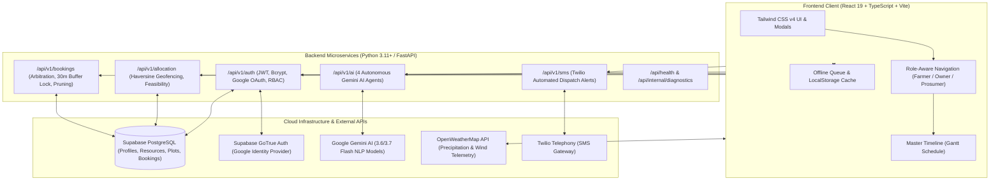

# AgriMart

> **Enterprise AI-Powered Agricultural Machinery Sharing, Fair Turn Priority Arbitration & Dynamic Field Scheduling Platform**

[](https://fastapi.tiangolo.com)
[](https://react.dev)
[](https://www.typescriptlang.org)
[](https://vitejs.dev)
[](https://tailwindcss.com)
[](https://supabase.com)
[](https://ai.google.dev)
[](https://www.twilio.com)
[](https://jwt.io)
[](backend/tests)

---

## Table of Contents

- [Overview](#overview)
- [System Architecture](#system-architecture)
- [Key Features](#key-features)
  - [1. Enterprise RBAC & JWT Security](#1-enterprise-rbac--jwt-security)
  - [2. Hybrid Google OAuth 2.0 & Mobile/Email Authentication](#2-hybrid-google-oauth-20--mobileemail-authentication)
  - [3. Deterministic 0–100 Fair Turn Priority Arbitration Engine](#3-deterministic-0100-fair-turn-priority-arbitration-engine)
  - [4. Autonomous Gemini AI Multi-Agent Mesh](#4-autonomous-gemini-ai-multi-agent-mesh)
  - [5. Conflict-Free Consecutive Auto-Scheduling](#5-conflict-free-consecutive-auto-scheduling)
  - [6. Spatial Geofencing & Customizable Serviceable Radius](#6-spatial-geofencing--customizable-serviceable-radius)
  - [7. Dual-Tier Cloud & Local-First Offline Resilience](#7-dual-tier-cloud--local-first-offline-resilience)
  - [8. Real-Time Telephony & Automated Weather Telemetry](#8-real-time-telephony--automated-weather-telemetry)
- [Role-Based Access Control (RBAC) Matrix](#role-based-access-control-rbac-matrix)
- [REST API Specification](#rest-api-specification)
- [Technology Stack](#technology-stack)
- [Project Directory Structure](#project-directory-structure)
- [Environment Variables](#environment-variables)
- [Installation & Getting Started](#installation--getting-started)
  - [Prerequisites](#prerequisites)
  - [Backend Setup (FastAPI)](#1-backend-setup-fastapi)
  - [Frontend Setup (React + Vite)](#2-frontend-setup-react--vite)
  - [Database Configuration (Supabase SQL)](#3-database-configuration-supabase-sql)
  - [Running the Application](#4-running-the-application)
- [Running Unit Tests](#running-unit-tests)
- [License](#license)

---

## Overview

During hyper-critical planting, spraying, and harvesting windows, smallholder farmers face severe equipment shortages, double-booking disputes, and arbitrary lender favoritism. When adverse weather looms, a single day's delay in securing a combine harvester or tractor can result in complete crop lodging and catastrophic financial loss.

**AgriMart** eliminates these bottlenecks by coupling a high-performance **Python FastAPI** cooperative engine with a responsive **React 19 + TypeScript** frontend. It features:
- A mathematically deterministic **0–100 Fair Turn Priority Arbitration Engine** that allocates equipment based on agronomic urgency, rain risk, crop shatter vulnerability, and turnaround proximity rather than wealth or social bias.
- **Consecutive non-overlapping auto-scheduling** with transit and hitching buffers.
- An **ongoing 30-minute buffer lock** preventing in-progress jobs from preemptive bumping.
- **Automatic pruning of elapsed bookings** to keep schedules accurate.
- Four specialized **Gemini AI Agents** that interpret regional rural vernaculars (Hindi, Punjabi, Haryanvi, Kannada, Telugu, English), evaluate dynamic field urgency, simulate catastrophic disruptions (monsoons, breakdowns), and generate plain-language village explanations.
- An **RBAC & JWT authentication system** with 12-round Bcrypt password hashing, phone/email sign-in, Google OAuth 2.0 with avatar CDN integration, and complete data privacy isolation.

---

## System Architecture



---

## Key Features

### 1. Enterprise RBAC & JWT Security
- **Role Hierarchy**: Structured support for four discrete system roles:
  - `borrower`: Smallholder farmer registering land plots, requesting machinery, and tracking field schedules.
  - `lender`: Equipment owner managing machinery listings, operational bounds, hourly pricing, and fleet revenue.
  - `prosumer`: Hybrid agriculturalist who both cultivates own land and leases out tractors/implements.
  - `admin`: Cooperative coordinator with system diagnostics, arbitration inspection, and manual override permissions.
- **Granular Permissions**: 12 fine-grained permissions (`plots:create`, `plots:read`, `plots:delete`, `resources:create`, `resources:manage`, `bookings:create`, `bookings:cancel`, `admin:arbitrate`, etc.) verified via FastAPI dependency injection guards (`require_roles`, `require_permissions`).
- **Bcrypt 12-Round Password Hashing**: Passwords and PINs are securely hashed using `bcrypt` ($2b$12$) before persistence. Plaintext passwords are never stored in databases or transmitted in responses.
- **Cryptographic JWT Tokens**: Issues signed HS256 JWT tokens containing `sub`, `email`, `phone`, `roles`, `permissions`, and expiration timestamp (`exp`). Tokens are passed via `Authorization: Bearer <token>` headers.
- **Pre-Registration Uniqueness Enforcement**: Strictly validates that neither email addresses nor mobile numbers are duplicated across accounts before registration.

### 2. Hybrid Google OAuth 2.0 & Mobile/Email Authentication
- **Unified Authentication**: Users can register and sign in using either:
  1. Indian Mobile Number (`+91` 10-digit) + Bcrypt Password.
  2. Email Address + Bcrypt Password.
  3. Google OAuth 2.0 one-click authentication.
- **One-Time Google Profile Onboarding**: First-time Google sign-ins trigger a streamlined onboarding modal prompting for village, state, and primary cooperative role. Returning Google users bypass this step automatically.
- **Google Avatar CDN Integration**: Renders user profile pictures with `referrerPolicy="no-referrer"` and `crossOrigin="anonymous"` to bypass Google User Content CDN (`lh3.googleusercontent.com`) 403 Forbidden hotlinking restrictions, with automatic fallback to user initials badges.
- **Secure Token Exchange**: Strips access tokens from browser history and callback URLs, transmitting authentication payloads strictly over POST bodies to prevent token leakage.

### 3. Deterministic 0–100 Fair Turn Priority Arbitration Engine
When multiple farmers compete for the same machinery, AgriMart replaces favoritism with an objective, verifiable mathematical scoring model:

$$\text{Priority Score} = S_{\text{urgency}} + S_{\text{weather}} + S_{\text{crop}} + S_{\text{wait}} + S_{\text{distance}} + S_{\text{criticality}}$$

| Component | Max Points | Evaluation Criteria |
|---|:---:|---|
| **Urgency & Deadline Proximity** | **25 pts** | Hours remaining before the requested operational window expires. |
| **Weather Risk Exposure** | **25 pts** | Imminent rainfall forecasts, rain volume ($\text{mm}$), and severe weather flags. |
| **Crop Vulnerability** | **20 pts** | Biological sensitivity (e.g., ripe Basmati paddy shatter risk vs. vegetative tillage). |
| **Anti-Starvation Wait Time** | **15 pts** | Cumulative waiting time in queue to prevent repeated deprioritization. |
| **Logistics & Transit Proximity** | **10 pts** | Haversine distance from equipment base to field plot and turnaround time. |
| **Work Criticality** | **5 pts** | Emergency harvesting and sowing given operational precedence over routine tasks. |

### 4. Autonomous Gemini AI Multi-Agent Mesh
Powered by Google Gemini 3.6/3.7 Flash models, AgriMart deploys four autonomous agents:
1. **Agent 1: Intake Normalization Agent**: Parses unstructured multi-dialect voice and text notes (Hindi, Punjabi, Haryanvi, Kannada, Telugu, English) into standardized structured booking parameters (plots, machinery types, acreage, deadlines).
2. **Agent 2: Arbitration Explanation Agent**: Generates respectful, clear, dialect-aware explanations in plain English and Hindi so deprioritized farmers understand exactly why Turn #1 was awarded to another field.
3. **Agent 3: Disruption Simulation Agent**: Handles emergency field crises (tractor mechanical breakdown, flash floods, unseasonal mud stalling), automatically calculating re-routing, buffer adjustments, and secondary lender assignments.
4. **Agent 4: Agronomic Urgency Evaluator**: Analyzes field crop condition notes, grain moisture percentages, and micro-climate forecasts to compute context-aware priority bonuses (0–10 pts).

### 5. Conflict-Free Consecutive Auto-Scheduling
- **No Overlapping Bookings**: If multiple requests target the same machinery, the highest-ranking candidate receives Turn #1.
- **Dynamic Transit & Hitching Buffers**: Automatically sequences competing bookings into consecutive, non-overlapping windows:
  $$\text{startTime}_2 = \text{endTime}_1 + \text{transitBufferMinutes}$$
  Transit buffer is computed using Haversine distance and rural transit velocity ($30\text{ km/h}$) plus mandatory implement hitching/unhitching time ($30\text{ min}$).
- **30-Minute Ongoing Buffer Lock**: Active bookings within 30 minutes of commencement or already in-progress are locked and cannot be preempted or bumped by new incoming emergency requests. The current farmer's work is guaranteed completion.
- **Automatic Pruning of Elapsed Bookings**: Completed or past bookings ($\text{endTime} \le \text{referenceNow}$) are automatically transitioned and pruned from the live dispatch timeline.

### 6. Spatial Geofencing & Customizable Serviceable Radius
- **Lender Customizable Service Bounds**: Machine owners can set their maximum serviceable distance cutoff (e.g., 15 km, 25 km, 50 km). Requests outside this perimeter are rejected automatically with clear conflict diagnostics.
- **Great-Circle Haversine Geodesics**: Precise spatial distance calculations between equipment depots and field plots using spherical trigonometry.

### 7. Dual-Tier Cloud & Local-First Offline Resilience
- **Supabase Cloud PostgreSQL**: Real-time cross-device synchronization with Row Level Security (RLS) policies.
- **Offline-First Local Queue**: When cellular connection drops in remote fields, plots and requests queue in browser `localStorage`. Upon reconnecting, an automated background worker syncs the queue to Supabase and FastAPI.

### 8. Real-Time Telephony & Automated Weather Telemetry
- **Twilio SMS Gateway**: Automated SMS dispatch notifications containing equipment arrival ETAs, lender contact information, and weather alerts.
- **Live Device GPS & Weather**: One-tap browser GPS detection combined with OpenWeatherMap REST telemetry (precipitation probability, wind velocity, humidity).

---

## Role-Based Access Control (RBAC) Matrix

| Permission | Borrower (Farmer) | Lender (Owner) | Prosumer (Both) | Admin (Coordinator) |
|---|:---:|:---:|:---:|:---:|
| `plots:create` | ✅ | ❌ | ✅ | ✅ |
| `plots:read` | ✅ (Own) | ❌ | ✅ (Own) | ✅ (All) |
| `plots:delete` | ✅ (Own) | ❌ | ✅ (Own) | ✅ |
| `resources:create` | ❌ | ✅ | ✅ | ✅ |
| `resources:read` | ✅ (All) | ✅ (All) | ✅ (All) | ✅ (All) |
| `resources:manage` | ❌ | ✅ (Own) | ✅ (Own) | ✅ (All) |
| `bookings:create` | ✅ | ❌ | ✅ | ✅ |
| `bookings:read` | ✅ (Own) | ✅ (Assigned) | ✅ (All Own) | ✅ (All) |
| `bookings:cancel` | ✅ (Creator) | ✅ (Owner) | ✅ | ✅ |
| `admin:arbitrate` | ❌ | ❌ | ❌ | ✅ |
| `admin:disruption` | ❌ | ❌ | ❌ | ✅ |
| `admin:access` | ❌ | ❌ | ❌ | ✅ |

---

## REST API Specification

Interactive Swagger UI documentation is available at `http://localhost:8000/docs` and ReDoc at `http://localhost:8000/redoc`.

### Authentication & RBAC (`/api/v1/auth`)
| Method | Endpoint | Description | Auth Required |
|---|---|---|:---:|
| `POST` | `/api/v1/auth/register` | Register farmer/owner with mobile or email, Bcrypt hash, and issue JWT | None |
| `POST` | `/api/v1/auth/login` | Authenticate credentials against Bcrypt hash and return JWT | None |
| `POST` | `/api/v1/auth/google` | Verify Google ID token, link/provision user, return JWT | None |
| `GET` | `/api/v1/auth/me` | Fetch authenticated user profile, roles, and permissions | Bearer JWT |
| `POST` | `/api/v1/auth/profile/update` | Update user profile fields (village, state, phone, roles) | Bearer JWT |
| `GET` | `/api/v1/auth/rbac/permissions` | Inspect effective RBAC permissions for active user | Bearer JWT |

### Allocation & Priority (`/api/v1`)
| Method | Endpoint | Description | Auth Required |
|---|---|---|:---:|
| `POST` | `/api/v1/feasibility` | Evaluate Haversine distance, lender radius, and transit buffers | None |
| `POST` | `/api/v1/priority` | Calculate deterministic 0–100 multi-factor priority score | None |
| `POST` | `/api/v1/evaluate-and-allocate` | Single-slot feasibility and priority evaluation pipeline | None |

### Bookings & Scheduling (`/api/v1/bookings`)
| Method | Endpoint | Description | Auth Required |
|---|---|---|:---:|
| `POST` | `/api/v1/bookings/schedule` | Arbitrate schedule, enforce 30m buffer lock, sequence slots | None |
| `POST` | `/api/v1/bookings/prune-elapsed` | Prune elapsed bookings ($\text{endTime} \le \text{now}$) from schedule | None |

### AI Agents & Disruptions
| Method | Endpoint | Description | Auth Required |
|---|---|---|:---:|
| `POST` | `/api/v1/intake/parse` | Agent 1: Multi-dialect voice/text intake normalization | None |
| `POST` | `/api/v1/arbitration/explain` | Agent 2: Dialect-aware arbitration explanation generator | None |
| `POST` | `/api/disruptions/simulate` | Agent 3: Breakdown & flood disruption re-allocation | None |
| `POST` | `/api/v1/urgency/evaluate` | Agent 4: Field crop and moisture urgency evaluator | None |

### SMS Gateway & Diagnostics
| Method | Endpoint | Description | Auth Required |
|---|---|---|:---:|
| `POST` | `/api/v1/sms/send` | Dispatch SMS alert via Twilio REST API | None |
| `GET` | `/api/health` | Health check endpoint with service capabilities | None |
| `GET` | `/api/internal/diagnostics` | Operational rules, buffer settings, and database status | None |

---

## Technology Stack

| Layer | Technology | Purpose |
|---|---|---|
| **Backend Framework** | **Python 3.11+ / FastAPI** | High-performance asynchronous REST API backend |
| **API Server** | **Uvicorn** | ASGI web server implementation |
| **Security & Auth** | **PyJWT (HS256)** + **Passlib (Bcrypt 12-Rounds)** | JWT token issuance, verification, and password hashing |
| **Data Validation** | **Pydantic v2** | Strict schema validation, serialization, and typing |
| **Frontend Framework** | **React 19.0** | Modern declarative UI component architecture |
| **Language & Typings** | **TypeScript 5.5+** | End-to-end static typing across components and APIs |
| **Styling & Design** | **Tailwind CSS v4** | Modern, responsive utility-first design system |
| **Build & Bundling** | **Vite 6.0** | Rapid HMR development server and optimized bundler |
| **Cloud Database** | **Supabase (PostgreSQL 15)** | Relational database with Row Level Security (RLS) |
| **Cloud Authentication**| **Supabase GoTrue (OAuth 2.0)** | Google OAuth identity provider integration |
| **AI / LLM Mesh** | **Google Gemini 3.6/3.7 Flash** | Vernacular NLP, urgency calculation, disruption simulation |
| **Weather Telemetry** | **OpenWeatherMap API** | Precipitation forecasts, rain volume, and wind metrics |
| **Telephony Gateway** | **Twilio REST API** | SMS booking dispatch and farmer arrival notifications |
| **Spatial Geodesics** | **Haversine Trigonometry** | Precise spherical distance calculations |
| **Icons & Motion** | **Lucide React** + **Motion** | Vector iconography and smooth micro-interactions |

---

## Project Directory Structure

```
AgriMart/
├── backend/                           # Python FastAPI Application
│   ├── app/
│   │   ├── core/
│   │   │   ├── config.py              # Environment variables & system constants
│   │   │   ├── rbac.py                # Roles, Permissions, & access verification
│   │   │   └── security.py            # Bcrypt hashing & JWT token operations
│   │   ├── db/
│   │   │   ├── database.py            # Database client & connection health
│   │   │   └── migrations/
│   │   │       └── 001_initial_schema.sql # PostgreSQL DDL migration script
│   │   ├── internal/
│   │   │   └── admin.py               # Health check & diagnostics endpoints
│   │   ├── models/
│   │   │   ├── booking.py             # Internal booking model representation
│   │   │   └── user.py                # User profile database model
│   │   ├── routers/
│   │   │   ├── ai_agents.py           # Gemini AI agent endpoints (Intake, Urgency, Explain)
│   │   │   ├── allocation.py          # Spatial feasibility & priority scoring
│   │   │   ├── auth.py                # Registration, login, Google OAuth, RBAC
│   │   │   ├── bookings.py            # Schedule arbitration, buffer locks, auto-prune
│   │   │   ├── disruptions.py         # Breakdown & flood simulation
│   │   │   └── sms.py                 # Twilio SMS dispatch
│   │   ├── schemas/
│   │   │   ├── ai_agent.py            # Pydantic models for AI payloads
│   │   │   ├── allocation.py          # Pydantic models for feasibility & scoring
│   │   │   ├── auth.py                # Pydantic models for auth & token claims
│   │   │   ├── booking.py             # Pydantic models for schedule arbitration
│   │   │   └── sms.py                 # Pydantic models for SMS payloads
│   │   ├── services/
│   │   │   ├── ai_service.py          # Gemini AI agent business logic
│   │   │   ├── auth_service.py        # Authentication & Supabase sync logic
│   │   │   ├── booking_service.py     # Consecutive scheduling & buffer locks
│   │   │   ├── feasibility_service.py # Haversine distance & geofencing checks
│   │   │   ├── geo_service.py         # Geographic utilities
│   │   │   ├── priority_service.py    # 0–100 Fair Turn scoring engine
│   │   │   └── sms_service.py         # Twilio REST API integration
│   │   ├── dependencies.py            # FastAPI dependency injection guards
│   │   └── main.py                    # FastAPI application initialization & CORS
│   ├── tests/                         # Comprehensive Unit Test Suite
│   │   ├── test_ai_agents.py          # AI agent NLP & explanation tests
│   │   ├── test_allocation.py         # Haversine distance & geofence tests
│   │   ├── test_auth.py               # Bcrypt, JWT, RBAC, & OAuth tests
│   │   ├── test_bookings.py           # 30m buffer lock & auto-prune tests
│   │   └── test_main.py               # Endpoint health & router tests
│   └── requirements.txt               # Backend Python dependencies
├── src/                               # Frontend Application (React 19 + TypeScript)
│   ├── components/
│   │   ├── AddResourceView.tsx        # Machinery listing & plot onboarding
│   │   ├── ArbitrationModal.tsx       # Fair Turn scorecard & AI explanation modal
│   │   ├── AuthModal.tsx              # Login, Register, & Google onboarding modal
│   │   ├── DeviceWeatherWidget.tsx    # Live device weather & rain risk badge
│   │   ├── DisruptionSimulatorModal.tsx # Fleet crisis & flood rerouting simulator
│   │   ├── EquipmentCardGrid.tsx      # Community equipment directory & filters
│   │   ├── FarmerActionPanel.tsx      # Urgent booking intake & voice parser
│   │   ├── Header.tsx                 # Navigation bar, user avatar & role switch
│   │   ├── Logo.tsx                   # AgriMart SVG brand mark
│   │   ├── MasterTimeline.tsx         # Chronological Gantt field schedule
│   │   ├── NotFoundPage.tsx           # 404 Out-of-bounds sector recovery & bento navigation
│   │   ├── OwnerActionPanel.tsx       # Equipment fleet management dashboard
│   │   ├── PlotsManager.tsx           # Farm land registry with crop & stage
│   │   ├── SentinelBar.tsx            # Connectivity, telemetry & sync status
│   │   └── SupabaseStatusModal.tsx    # Cloud database status & SQL setup helper
│   ├── lib/
│   │   ├── api.ts                     # FastAPI backend HTTP client & mapping
│   │   ├── deviceLocation.ts          # Browser GPS geolocation detector
│   │   ├── engine.ts                  # Client-side priority scoring & scheduling
│   │   ├── gemini.ts                  # Client Gemini AI multilingual dialect engine
│   │   ├── offlineSync.ts             # Local-first offline queue synchronization
│   │   ├── sms.ts                     # Telephony dispatch integration
│   │   ├── storage.ts                 # Local storage manager with cloud sync
│   │   ├── supabase.ts                # Supabase client, queries & realtime listener
│   │   └── weather.ts                 # OpenWeatherMap client & rain risk evaluator
│   ├── types/
│   │   └── index.ts                   # Domain models & TypeScript interfaces
│   ├── App.tsx                        # Main application container
│   ├── index.css                      # Tailwind CSS v4 styling definitions
│   └── main.tsx                       # React application entrypoint
├── public/                            # Public assets & icons
├── .env                               # Local environment configuration (Git-ignored)
├── .env.example                       # Sanitized template for environment variables
├── .gitignore                         # Git ignore rules
├── index.html                         # HTML template
├── package.json                       # Frontend dependencies & npm scripts
├── supabase_setup.sql                 # Complete Supabase PostgreSQL DDL & RLS schema
├── tsconfig.json                      # TypeScript compiler configuration
├── vite.config.ts                     # Vite build & proxy configuration
└── README.md                          # Comprehensive project documentation
```

---

## Environment Variables

Copy `.env.example` to `.env` in the root directory. All keys are loaded by both the FastAPI backend and Vite frontend:

```env
# ==============================================================================
# 1. Weather Prediction & Forecast (OpenWeatherMap)
# ==============================================================================
VITE_OPENWEATHER_API_KEY=your_openweather_api_key
OPENWEATHER_API_KEY=your_openweather_api_key

# ==============================================================================
# 2. Google Gemini AI Engine (Intake NLP, Explanations, Disruptions)
# ==============================================================================
VITE_GEMINI_API_KEY=your_gemini_api_key
GEMINI_API_KEY=your_gemini_api_key

# ==============================================================================
# 3. Twilio SMS Dispatch & Notifications
# ==============================================================================
VITE_TWILIO_ACCOUNT_SID=your_twilio_account_sid
TWILIO_ACCOUNT_SID=your_twilio_account_sid
VITE_TWILIO_AUTH_TOKEN=your_twilio_auth_token
TWILIO_AUTH_TOKEN=your_twilio_auth_token
VITE_TWILIO_PHONE_NUMBER=+1234567890
TWILIO_PHONE_NUMBER=+1234567890

# ==============================================================================
# 4. Supabase Cloud PostgreSQL Database & Auth
# ==============================================================================
VITE_SUPABASE_URL=https://your-project.supabase.co
SUPABASE_URL=https://your-project.supabase.co
VITE_SUPABASE_ANON_KEY=your_supabase_anon_key
SUPABASE_ANON_KEY=your_supabase_anon_key

# ==============================================================================
# 5. JWT Authentication & RBAC (Cryptographic 256-Bit Secret Key)
# ==============================================================================
JWT_SECRET_KEY=agrimart_jwt_sec_minimum_32_characters_long_secret_key
JWT_ACCESS_TOKEN_EXPIRE_MINUTES=10080

# ==============================================================================
# 6. Google OAuth 2.0 Client Credentials
# ==============================================================================
GOOGLE_CLIENT_ID=your_google_oauth_client_id
VITE_GOOGLE_CLIENT_ID=your_google_oauth_client_id
```

---

## Installation & Getting Started

### Prerequisites
- **Node.js**: v18.0.0 or higher
- **npm**: v9.0.0 or higher
- **Python**: v3.11 or higher
- **pip** and `virtualenv`

### 1. Backend Setup (FastAPI)

1. Navigate to the project root and create a Python virtual environment:
   ```bash
   python -m venv .venv
   ```

2. Activate the virtual environment:
   - **Windows (PowerShell)**:
     ```powershell
     .\.venv\Scripts\Activate.ps1
     ```
   - **macOS / Linux**:
     ```bash
     source .venv/bin/activate
     ```

3. Install backend dependencies:
   ```bash
   pip install -r backend/requirements.txt
   ```

### 2. Frontend Setup (React + Vite)

1. Install frontend packages:
   ```bash
   npm install
   ```

### 3. Database Configuration (Supabase SQL)

1. Open your Supabase project dashboard and navigate to the **SQL Editor**.
2. Run the queries from [supabase_setup.sql](supabase_setup.sql). This will:
   - Create tables: `profiles`, `resources`, `plots`, `bookings`.
   - Configure columns: `password_hash`, `avatar_url`, `role_flags`, `max_serviceable_distance_km`.
   - Set up Row Level Security (RLS) policies for user isolation.

### 4. Running the Application

You can run both the backend and frontend concurrently:

#### Terminal 1 — Start the FastAPI Backend
```bash
# From project root with virtual environment active:
uvicorn backend.app.main:app --host 127.0.0.1 --port 8000 --reload
```
The backend API and documentation will be accessible at:
- Interactive Swagger UI: `http://127.0.0.1:8000/docs`
- ReDoc API Reference: `http://127.0.0.1:8000/redoc`
- Health Endpoint: `http://127.0.0.1:8000/api/health`

#### Terminal 2 — Start the Vite Development Server
```bash
# From project root:
npm run dev
```
The web application will open at:
- Web App: `http://localhost:3000`

> **Note**: Vite is preconfigured with an automatic reverse proxy forwarding `/api/*` requests directly to `http://127.0.0.1:8000`.

---

## Running Unit Tests

AgriMart maintains a comprehensive automated test suite covering all backend services:

```bash
# Run all 31 unit tests across auth, allocation, scheduling, and AI modules
python -m unittest discover -s backend/tests -v
```

### Test Coverage Highlights:
- **`test_auth.py`** (17 tests): Bcrypt hashing, verification, invalid password rejection, JWT token creation, claim payload decoding, tampered token rejection, expiration, RBAC role expansion (prosumer inheritance), permissions check, and duplicate phone/email prevention.
- **`test_allocation.py`** (5 tests): Haversine distance calculation, geofencing bounds, lender customizable max serviceable radius cutoff, temporal feasibility buffers, and emergency vs. routine priority scoring.
- **`test_bookings.py`** (2 tests): 30-minute buffer lock protection on ongoing operations, sequential slot arbitration, and automatic elapsed booking pruning.
- **`test_ai_agents.py`** (4 tests): Multi-dialect voice/text intake normalization, arbitration explanations, disaster simulation, and contextual urgency calculation.
- **`test_main.py`** (3 tests): Health check endpoint, diagnostics telemetry, and router registration.

To run frontend type checking and production builds:
```bash
# TypeScript verification
npx tsc --noEmit

# Optimized production bundle
npm run build
```

---

## License

This project is licensed under the **MIT License** — see the [LICENSE](LICENSE) file for details.
